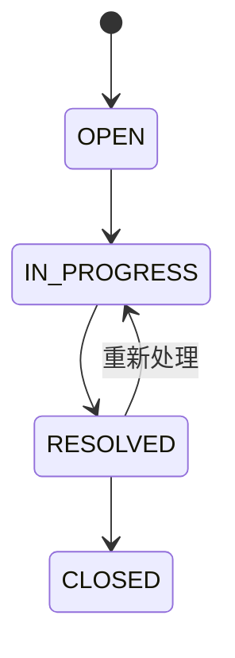

# 工单管理后台

面向应届 Java 后台岗位的可运行项目。业务闭环是：创建工单 → 接单 → 解决 → 关闭 → 查看审计记录。重点展示 Java/Spring/MyBatis、事务与并发控制、MySQL 查询优化、Redis 缓存。

## 1. 最快启动：无需外部服务

要求 JDK 21、Maven 3.6.3+、Python 3（仅用于演示脚本）。在项目根目录执行：

```bash
mvn clean verify
java -jar target/smart-ticket-1.0.0.jar
```

另开终端运行：

```bash
cd /home/zys/Project/java
python3 scripts/demo.py
```

默认账号 `admin`，密码 `demo-password`；这是本地演示凭据。默认 `demo` 模式使用 H2 内存数据库，重启后工单消失，表结构由 Flyway 重建；不启用 Redis。

```bash
curl -u admin:demo-password http://localhost:8080/api/tickets
curl http://localhost:8080/actuator/health
```

## 2. MySQL + Redis：使用 Podman

无需修改 Docker 或系统代理配置。脚本直接调用 Podman，不依赖额外 Compose provider。

```bash
cp .env.example .env
# 编辑 .env，设置三个密码
bash scripts/deps.sh up
# 查看日志，等待 MySQL 出现 ready for connections
podman logs smart-ticket-mysql
mvn clean package
bash scripts/run-mysql.sh
```

另开终端：

```bash
set -a
source .env
set +a
python3 scripts/demo.py
# 验证真实 Redis 的回填、TTL 和提交后失效
python3 scripts/verify-cache.py
# 可选故障演练，会暂时停止本项目 Redis 并在 finally 中恢复
python3 scripts/verify-cache.py --outage
```

MySQL 默认端口 `13306`，Redis 默认端口 `16379`，只绑定本机地址，避免占用已有默认端口。数据库使用 `smart-ticket-mysql-data` 命名卷。依赖脚本首次启动会创建容器；已有同名容器时用 `podman start smart-ticket-mysql smart-ticket-redis`。

```bash
# 停止并移除本项目容器，保留 MySQL 数据卷
bash scripts/deps.sh down
```

也提供兼容 Compose 文件：如果已安装 Podman Compose provider，可用 `podman compose up -d`，然后启动 Java 应用。**脚本方式与 Compose 方式选一种**，两者使用不同容器名称和数据卷，但默认端口相同。

容器化应用的可选方式：

```bash
mvn package
podman build -t localhost/smart-ticket:1.0 -f Containerfile .
podman run --rm --name smart-ticket-app -p 127.0.0.1:8080:8080 localhost/smart-ticket:1.0
```

上述应用容器默认运行 H2 演示模式；接 MySQL 时需另外配置容器网络和环境变量，不要把容器内的 localhost 当作宿主机。

## 3. API

除健康检查外均需 Basic 认证。当前采用单团队共享工单池，所有 ADMIN 账号可访问所有工单；非多租户权限系统。参数使用 Bean Validation 校验，SQL 参数全部使用 MyBatis `#{}` 绑定。

| 方法 | 路径 | 说明 |
| --- | --- | --- |
| POST | `/api/tickets` | 创建工单，返回 201 和 Location |
| GET | `/api/tickets?status=OPEN&size=20&beforeId=100` | 游标分页，size 为 1～100 |
| GET | `/api/tickets/{id}` | 工单详情，MySQL 模式使用 Redis |
| POST | `/api/tickets/{id}/transitions` | 带版本号的状态流转 |
| GET | `/api/tickets/{id}/events` | 最早 100 条审计记录 |
| GET | `/actuator/health` | 健康检查 |
| GET | `/actuator/metrics` | 认证后查询运行指标 |

创建请求：

```json
{"title":"重复扣款","description":"同一订单发生两次扣款","category":"PAYMENT","priority":"HIGH"}
```

状态更新请求：

```json
{"target":"IN_PROGRESS","version":0,"note":"已接单，核查支付流水"}
```

`version` 是详情或列表中的版本号，必传；过期版本或非法状态流转返回 409。不存在返回 404，非法参数返回 400，未认证返回 401。发生版本冲突时重新读取工单再决定是否重试。详情缓存可能短暂陈旧，列表直读数据库。

允许的状态流转：



## 4. 验证和面试准备

```bash
mvn verify
# 使用演示脚本返回的真实工单 ID
python3 scripts/benchmark.py --ticket-id 1 --requests 200 --workers 8
```

自动化测试覆盖鉴权、参数、审计、游标翻页、非法流转、旧版本拒绝、8 个并发更新只成功一个，以及审计写入失败时事务回滚。H2 测试不能替代 MySQL 的执行计划和 Redis 实测，真实依赖验证记录见 [验证报告](docs/verification.md)。

- [面试讲解与 JD 对照](docs/interview.md)：3 分钟介绍、技术追问和真实简历表述。
- [设计与一致性边界](docs/design.md)：架构、事务、缓存和后续演进。
- [MySQL 优化实验](docs/mysql-optimization.md)：10 万行数据、深分页对比和执行计划。
- [验证记录](docs/verification.md)：本次实际执行结果。

项目是面试作品原型。可解释的核心已实现；上线前仍需独立身份认证、团队权限隔离、限流、密钥管理、审计分页。未实现 Spring Cloud，相关拆分思路写在设计文档中，不把它当作已完成能力。
