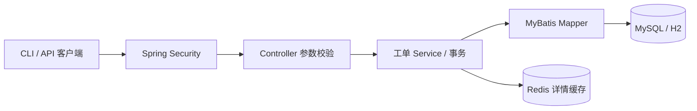

# 设计与一致性边界

## 架构

Controller 负责协议与参数；Service 管业务规则和事务；Mapper 使用绑定 SQL；domain 封装状态规则。缓存接口在 demo 模式使用空实现、mysql 模式使用 Redis，避免业务代码到处判断运行环境。

## 状态更新为何可靠

1. 读取数据库，检查客户端版本及状态规则。
2. 执行 `UPDATE ... WHERE id=? AND version=? AND status=?`，同时递增版本。
3. 受影响行数不是 1 时返回 409；不自动重试改变用户操作意图。
4. 状态更新和审计插入在同一个 Spring 事务中。任何一步失败均回滚。
5. 事务提交后删除缓存；返回写入后的数据库对象。

即使两个请求同时读到 version=0，数据库原子 UPDATE 也只允许一个成功。需要版本条件，单靠 Java 中的 `if` 或 `synchronized` 无法覆盖多实例。版本检查不会让重复 POST 变成幂等请求：创建接口没有幂等键，客户端失败重试可能创建重复工单。

审计 actor 来自认证主体，不接受客户端传入。当前所有用户属于同一个团队池，尚无 owner/team 行级权限。

## Redis 策略与代价

详情读取使用 cache-aside：命中返回；未命中读 DB 并设置 30～44 秒随机 TTL；状态变更提交后删除缓存。Redis 连接或操作异常时回源或跳过缓存写入，业务事务不依赖 Redis。日志不包含密码或工单描述。

存在两个边界：删除失败时旧项存活至 TTL；并发旧读可能在删除后回填旧值。TTL 限定的是缓存项自写入后的存活时间，不承诺从数据库提交时刻起严格 44 秒收敛。缓存详情不用于状态更新校验；列表及更新都直读 DB。涉及资金余额、权限判断等强一致性数据，不应照搬这个缓存设计。

随机 TTL 仅缓解集中失效，未实现热点互斥、分布式锁、空值缓存、布隆过滤器或入口限流。异常请求重复查询不存在的 ID 仍会回源。Redis 不可用时健康检查可能 DOWN，但存量 API 查询仍可按降级路径工作。

## 数据查询

列表只投影必要字段，避免读取 4000 字的描述；`size+1` 判断下一页，不做 COUNT；按 id DESC 返回。状态过滤使用 `(status,id)` 索引，无状态过滤可走主键。跨页期间新增记录不会挤入更小 id 的下一页，但已存在行的状态变化仍会影响结果，不是数据库快照。客户端无法直接跳到第 500 页，也没有总页数。

审计目前仅返回最早 100 条，避免无限响应；真实系统应支持 `afterEventId` 分页。

## 可演进但尚未实现

规模增大后可把通知模块拆成独立服务，使用 Spring Cloud Gateway 做入口治理；同步调用要配置超时、熔断和隔离。状态变更后发通知可引入 outbox，将业务和事件写入同一事务，由后台发布、消费端去重。不需要为了应届作品先引入分布式事务和多套服务。

当前 Basic API 演示关闭 CSRF，适合脚本客户端；若加入浏览器登录应改为合适的 token 或会话方案，并重新评估 CSRF。上线启用 HTTPS、替换默认账号、限制管理端点访问，并执行依赖审计。
